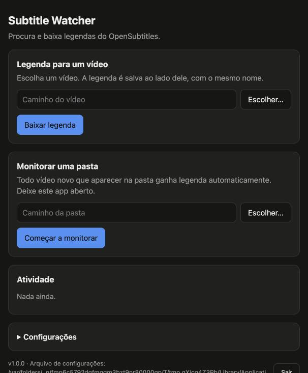
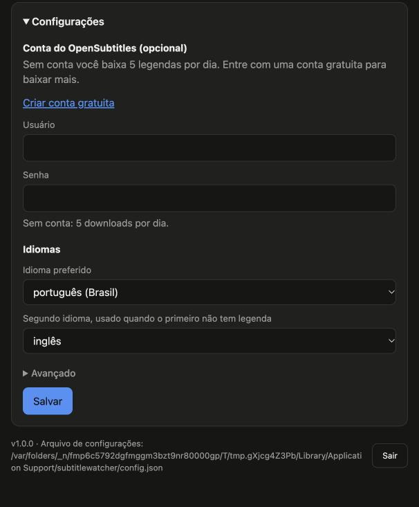

# subtitlewatcher

[Português](README.pt-BR.md)

Downloads subtitles from [OpenSubtitles](https://www.opensubtitles.com) for your videos. Pick a video and get its subtitle, or point it at a folder and every new video that shows up there gets one automatically.



- Simple window that opens in your browser, in English or Portuguese.
- Finds the subtitle by the file fingerprint first, so it matches your exact release.
- Two languages in order of preference, for example Brazilian Portuguese and then English.
- Command line for scripts and servers.
- One small file, nothing to install, works on macOS, Windows, Linux and FreeBSD.

## Download

Get the latest version on the [releases page](https://github.com/polotto/subtitlewatcher/releases/latest):

| System | File |
| --- | --- |
| macOS (Intel and Apple Silicon) | `subtitlewatcher-<version>-macos.zip` |
| Windows | `subtitlewatcher-<version>-windows-x64.zip` (or `-arm64` for ARM laptops) |
| Linux | `subtitlewatcher-<version>-linux-x64.tar.gz` (also `arm64` and `armv7` for Raspberry Pi) |
| FreeBSD | `subtitlewatcher-<version>-freebsd-x64.tar.gz` |

Each release has a `checksums.txt` with the SHA-256 of every file.

## First run

**macOS.** Unzip and double click `subtitlewatcher`. The app is not signed by Apple, so the first time macOS blocks it. Open **System Settings > Privacy & Security**, click **Open Anyway** next to the subtitlewatcher message and confirm. A Terminal window opens together with the app: keep it open while you use it.

**Windows.** Unzip and double click `subtitlewatcher.exe`. If SmartScreen shows "Windows protected your PC", click **More info** and then **Run anyway**. A console window opens together with the app: keep it open while you use it.

**Linux and FreeBSD.** Extract and run `./subtitlewatcher` in a terminal.

The app opens a page in your default browser. If it does not, copy the address printed in the terminal window.

## Using it

- **Subtitle for a video**: click **Choose…**, pick the video and click **Download subtitle**. The subtitle is saved next to the video with the same name, so players load it automatically.
- **Watch a folder**: pick a folder (your Downloads folder, for example) and click **Start watching**. Every video that appears there or in its subfolders gets a subtitle once it finishes copying. Videos that already have a `.srt` are skipped. Watching only works while the app is open.
- **Activity** lists what happened, including how many downloads you have left today.
- **Quit** closes the app. Closing the terminal window does the same.

## OpenSubtitles account (optional)

The app works without an account, with a limit of **5 subtitles per day**. To download more:

1. Create a free account at [opensubtitles.com](https://www.opensubtitles.com/en/users/sign_up).
2. In the app, open **Settings**, fill **Username** and **Password** under "OpenSubtitles account" and click **Save**.
3. The app signs in right away and shows your level and how many downloads you have left today. If the password is wrong it tells you so and does not try again until you save new details.



The **Advanced** section has an API key field. You do not need it with the official downloads, which already include a key. Fill it only to use your own key from [opensubtitles.com/consumers](https://www.opensubtitles.com/consumers) or when you built the app yourself.

## Command line

```sh
subtitlewatcher get movie.mkv                   # one or more videos
subtitlewatcher -lang en,es get *.mp4           # other languages
subtitlewatcher watch ~/Downloads               # watch a folder until Ctrl+C
subtitlewatcher -every 30s watch /media/videos  # scan less often
subtitlewatcher version
```

The command line uses the same settings saved by the window. These environment variables take precedence:

| Variable | Use |
| --- | --- |
| `OPENSUBTITLES_USERNAME`, `OPENSUBTITLES_PASSWORD` | Account login |
| `OPENSUBTITLES_API_KEY` | Your own API key |

## Troubleshooting

| Message | What to do |
| --- | --- |
| No subtitle found in the chosen languages | Try a second language in Settings. Some videos have no subtitle on OpenSubtitles yet. |
| Daily download limit reached | Wait until tomorrow or sign in with an account. |
| Wrong username or password | Fix them in Settings and save. |
| OpenSubtitles refused the API key | Clear the key in Settings, Advanced, to use the built-in one, or create a new key. |
| No file dialog on this system | On Linux install `zenity` or `kdialog`, or paste the path in the field. |

## Privacy

- Settings live in `config.json` inside `~/Library/Application Support/subtitlewatcher` (macOS), `%AppData%\subtitlewatcher` (Windows) or `~/.config/subtitlewatcher` (Linux). The password is stored there as plain text, readable only by your user.
- The app only talks to `api.opensubtitles.com`. The page runs on your own computer (`127.0.0.1`) and other sites cannot control it.

## Building from source

```sh
go build .                                   # needs Go 1.24
OPENSUBTITLES_API_KEY=... go run .           # without a built-in key, pass yours
scripts/dist.sh 1.2.3                        # archives for every platform in dist/
```

Maintainers: see [docs/RELEASING.md](docs/RELEASING.md).

## License

[MIT](LICENSE)
